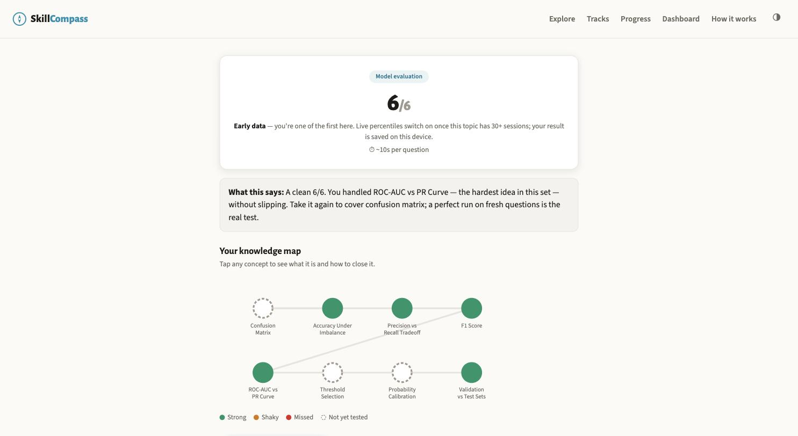

# SkillCompass

[](https://github.com/lyhjeremy/skill-compass/actions/workflows/tests.yml)

A line on a résumé is a claim with no evidence behind it. SkillCompass turns each skill into a free two-minute check (one placement question and six more, Elo-scored, no sign-up), then uses an LLM to compare a résumé with a career track, run a mock interview and write a study guide, on a stack that costs $0 a month.

Result, 5 November 2026: 645 questions are live across 29 subtopics, and an independent review pass rewrote 266 of the 645 drafts before they shipped (`eval/review_pass.json`). What it missed: 415 of the 645 answer keys (64%) were option A as drafted; the app now shuffles options on every showing, and on 5 November `scripts/rebalance_keys.py` reordered the stored bank to 165, 164, 158 and 158 keys at A to D. Percentiles are off while the free-tier Supabase project is paused.

[Live app (beta)](https://lyhjeremy.github.io/skill-compass/) · [Product overview](https://lyhjeremy.github.io/skill-compass/overview/) · [Build log](writeup.md)

Design and copy follow [these standards](https://github.com/lyhjeremy/lyhjeremy/blob/main/DESIGN_STANDARDS.md).



## What it does

| Area | Details |
|---|---|
| Live content | 4 career tracks (Data Analyst, Data Scientist/ML, BI Analyst, Business/Product Analytics), 29 subtopics, 645 questions (model-drafted and model-reviewed; every bank is still marked pending human review) |
| Catalog | 385 subtopics across 46 fields and 117 career tracks in `content/catalog.json`; each goes live when its question bank lands |
| Scoring | Elo-style ability estimate per session, item ratings from difficulty priors, adaptive placement |
| Percentiles | Rank among sessions on the same subtopic in a rolling 90-day window, shown once a subtopic has 30 sessions |
| LLM features | Resume gap report (text or image), 6 to 8 turn mock interview with a scorecard, personalized study guide |
| Cost | $0/month: GitHub Pages, a Hugging Face Space, Supabase free tier, Gemini free tier |

## How scoring works

Each question carries a difficulty prior *p*, the estimated probability that a median professional answers it correctly. The content pipeline sets *p* when it drafts the question and an independent reviewer pass re-estimates it. The app converts *p* to an Elo item rating:

```
R_item = 1500 − 400 · log10(p / (1 − p))
E      = 1 / (1 + 10^((R_item − R_session) / 400))
R_session ← R_session + 48 · (correct − E)
```

A session starts with one placement question near median difficulty. A wrong answer routes to the easy set (starting rating 1350), a right answer in under 20 seconds to the hard set (1650), and a slower right answer to the standard set (1500). The six-question set is drawn unseen-first, so retakes see new questions. The final session rating is the score that percentiles are computed on. The code is in `frontend/src/lib/elo.ts` and `frontend/src/lib/store.ts`.

The backend logs every completed session and every response (item, concept, correctness, response time, first exposure) to Postgres. The percentile is the share of sessions on that subtopic in the last 90 days with a lower final rating; below 30 sessions the app shows an "early data" label instead of a number. The per-item response logs are kept so that item ratings can later be recalibrated from user answers, using the decaying-K update shown on the app's How it works page (K = 32/(1+n/40)). That step is not built yet, so item ratings still come from the priors.

## LLM features

All three go through one `gemini_generate()` helper in `backend/app/main.py`. It calls the Gemini REST API with the standard library (there is no SDK), defaults to `gemini-2.5-flash` with thinking turned off, and stops at a daily call cap (1,200 by default) that the app shows as a capacity meter.

The resume gap report (`/api/resume`, `/api/resume-image`) matches resume text against a track's own curriculum and marks which subtopics the resume claims, so the user can go and verify each one with a check. Images fall back to local tesseract OCR when Gemini is unavailable. A resume is used for one call and never stored.

The mock interview (`/api/interview`) runs 6 to 8 text turns pitched at the level the user has demonstrated, follows up on thin answers and ends with a per-dimension scorecard. It is stateless; the frontend resends the transcript each turn. Candidate answers are wrapped in `<candidate_answer>` tags under an explicit security rule against prompt injection, and `backend/tests/test_injection_defense.py` checks that the defense is wired into the prompt.

The study guide (`/api/guide`) is a downloadable Markdown plan for a whole track, built from per-concept quiz results plus the resume and interview context when they exist.

## Architecture

| Layer | Stack | Runs on |
|---|---|---|
| Frontend | React, Vite, TypeScript | GitHub Pages (static) |
| API | Python FastAPI with stdlib-only REST clients for Supabase and Gemini | Hugging Face Space (Docker, free CPU) |
| Calibration data | Anonymous session and response log | Supabase Postgres (free tier, row-level security on) |
| LLM features | Gemini 2.5 Flash | Google AI free tier |
| Content pipeline | `claude -p` draft, independent adversarial review, then human review (not yet done for any bank) | Local |

The quiz loop makes no server calls: questions ship as static JSON, and scoring, the knowledge map and the diagnosis run in the browser. If the API is down the checks still work; only percentiles and the LLM features stop. User state lives in localStorage (`sc_v1`) and can be exported or erased from the Progress page. A GitHub Actions cron pings the API twice a week to keep the Supabase project active, and it checks the response bodies as well as the status codes. As of 2026-10-28 the project is paused anyway (`/api/health` reports `supabase: false`) and that job failed on every run from 2026-08-06 until GitHub disabled the schedule for inactivity after the 2026-10-19 run, so no sessions are being logged until it is resumed from the Supabase dashboard.

## Running locally

```bash
cd frontend && npm install && npm run dev     # app on http://localhost:5173/skill-compass/ (syncs content first)

cd backend && python3 -m venv .venv && source .venv/bin/activate
pip install -r requirements.txt && uvicorn app.main:app --reload   # API on :8000
```

The backend reads `SUPABASE_URL` and `SUPABASE_KEY` (percentiles) and `GEMINI_API_KEY` (LLM features), with `GEMINI_MODEL` and `GEMINI_DAILY_CAP` as optional overrides. Without them it runs with those features off. `backend/schema.sql` creates the three tables. The frontend calls the deployed API unless `VITE_API_BASE` is set (`VITE_API_BASE=http://localhost:8000 npm run dev` uses the local one). Backend tests, from `backend/` with the venv active: `pip install pytest httpx && python -m pytest tests/ -q`. Deploying the backend is covered in [`backend/README.md`](backend/README.md).

## Repo layout

| Path | Contents |
|---|---|
| `frontend/` | React app: quiz engine, knowledge map, results, tracks, progress |
| `frontend/src/lib/elo.ts` | Item rating, expected score, session update, placement routing, set drawing |
| `frontend/src/lib/store.ts` | localStorage schema `sc_v1` |
| `frontend/src/lib/api.ts` | Client for session logging and the LLM endpoints |
| `frontend/public/overview/` | The hand-maintained product overview page and its screenshots |
| `backend/app/main.py` | FastAPI service: health, quota, session, aggregates, feedback, resume, interview, guide |
| `backend/schema.sql` | Postgres tables for sessions, responses and feedback |
| `content/catalog.json` | The full catalog: fields, subtopics, tracks |
| `content/manifest.json` | What is live; built by `scripts/build_manifest.py` from whatever banks exist |
| `content/subtopics/` | The 29 live question banks with concept graphs |
| `scripts/gen_questions.py` | Two-pass question generation: draft in difficulty bands, then adversarial verify |
| `scripts/validate_content.py` | Schema and range checks on the banks |
| `scripts/rebalance_keys.py` | Reorders each question's options so key positions are even per subtopic (fixed seed); applies `explanation_letter_fixes.json` first |
| `.github/workflows/` | Pages deploy, Space deploy, keep-alive cron |

## Limitations

The Supabase project is paused as of 2026-10-28, so percentiles and session logging are off; the checks themselves still run in the browser. Item ratings are LLM-estimated priors until response-based recalibration is built. Percentiles need 30 sessions per subtopic in a 90-day window, so most subtopics still show "early data". The resume report compares against each track's curriculum; with no job-postings corpus yet, it makes no claims about market demand. Only 29 of the 385 catalog subtopics are live, and the rest show as coming soon. As drafted, 415 of the 645 keys were option A. Until 4 November the app showed options in stored order, so always picking A scored well above chance. It now shuffles them on every showing, and since 5 November the stored order is balanced too (no letter holds more than 28% of any subtopic's keys); 31 explanations that named options by letter were rewritten to name them by content. The free tiers have their own limits, too: the Supabase project pauses after 7 days without activity, and Gemini calls are capped per day.

## License

[MIT](LICENSE) © 2026 Jeremy Lee
