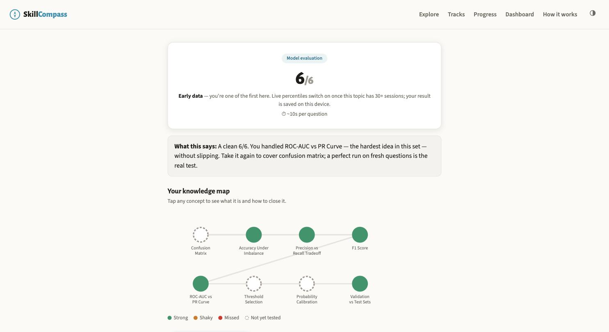

# SkillCompass

A free skill-assessment web app: take a 2-minute check, get an Elo-rated score, a percentile against other test-takers and a map of which concepts are strong or shaky, then use LLM features to compare your resume against a career track, sit a mock interview and get a study guide. No sign-up, and the whole stack runs at $0 a month.

[Live app (beta)](https://lyhjeremy.github.io/skill-compass/) · [Product overview](https://lyhjeremy.github.io/skill-compass/overview/) · [Build log](writeup.md)

Design and copy follow [these standards](https://github.com/lyhjeremy/lyhjeremy/blob/main/DESIGN_STANDARDS.md).



## What it does

| Area | Details |
|---|---|
| Live content | 4 career tracks (Data Analyst, Data Scientist/ML, BI Analyst, Business/Product Analytics), 29 subtopics, 645 reviewed questions |
| Catalog | 385 subtopics across 46 fields and 117 career tracks in `content/catalog.json`; each goes live when its question bank lands |
| Scoring | Elo-style ability estimate per session, item ratings from difficulty priors, adaptive placement |
| Percentiles | Rank among sessions on the same subtopic in a rolling 90-day window, shown once a subtopic has 30 sessions |
| LLM features | Resume gap report (text or image), 6 to 8 turn mock interview with a scorecard, personalized study guide |
| Cost | $0/month: GitHub Pages, a Hugging Face Space, Supabase free tier, Gemini free tier |

## How scoring works

Each question carries a difficulty prior *p*, the estimated probability that a median professional answers it correctly. The content pipeline sets *p* when it drafts the question and an independent reviewer pass re-estimates it. The app converts *p* to an Elo item rating:

```
R_item = 1500 − 400 · log10(p / (1 − p))
E      = 1 / (1 + 10^((R_item − R_session) / 400))
R_session ← R_session + 48 · (correct − E)
```

A session starts with one placement question near median difficulty. A wrong answer routes to the easy set (starting rating 1350), a right answer in under 20 seconds to the hard set (1650), and a slower right answer to the standard set (1500). The six-question set is drawn unseen-first, so retakes see new questions. The final session rating is the score that percentiles are computed on. The code is in `frontend/src/lib/elo.ts` and `frontend/src/lib/store.ts`.

The backend logs every completed session and every response (item, concept, correctness, response time, first exposure) to Postgres. The percentile is the share of sessions on that subtopic in the last 90 days with a lower final rating; below 30 sessions the app shows an "early data" label instead of a number. Per-item response logs are stored so item ratings can be recalibrated from real answers with the decaying-K update shown on the app's How it works page (K = 32/(1+n/40)). That recalibration step is not yet implemented; item ratings currently come from the priors.

## LLM features

All three run through one `gemini_generate()` helper in `backend/app/main.py` that calls the Gemini REST API with the standard library (no SDK), default model `gemini-2.5-flash` with thinking turned off, and a daily call cap (1,200 by default) shown in the app as a capacity meter.

- **Resume gap report** (`/api/resume`, `/api/resume-image`): matches resume text against a track's own curriculum and marks which subtopics the resume claims, so the user can verify them with a check. Images fall back to local tesseract OCR when Gemini is unavailable. Resumes are used for one call and never stored.
- **Mock interview** (`/api/interview`): a 6 to 8 turn text interview pitched to the level the user has demonstrated, with follow-ups on thin answers and a per-dimension scorecard at the end. It is stateless: the frontend resends the transcript each turn. Candidate answers are wrapped in `<candidate_answer>` tags under an explicit security rule against prompt injection; `backend/tests/test_injection_defense.py` checks that the defense is wired into the prompt.
- **Study guide** (`/api/guide`): a downloadable Markdown plan for a whole track, built from per-concept quiz results and, when present, the resume and interview context.

## Architecture

| Layer | Stack | Runs on |
|---|---|---|
| Frontend | React, Vite, TypeScript | GitHub Pages (static) |
| API | Python FastAPI with stdlib-only REST clients for Supabase and Gemini | Hugging Face Space (Docker, free CPU) |
| Calibration data | Anonymous session and response log | Supabase Postgres (free tier, row-level security on) |
| LLM features | Gemini 2.5 Flash | Google AI free tier |
| Content pipeline | `claude -p` draft, independent adversarial review, human review | Local |

The quiz loop makes no server calls: questions ship as static JSON, and scoring, the knowledge map and the diagnosis run in the browser. If the API is down, checks still work and only percentiles and the LLM features stop. User state lives in localStorage (`sc_v1`) and can be exported or erased from the Progress page. A GitHub Actions cron pings the API twice a week to keep the Supabase project active and checks the response bodies, not only the status codes.

## Running locally

```bash
cd frontend && npm install && npm run dev     # app on :5173 (syncs content first)
cd backend && pip install -r requirements.txt && uvicorn app.main:app --reload
```

The backend reads `SUPABASE_URL` and `SUPABASE_KEY` (percentiles) and `GEMINI_API_KEY` (LLM features), with `GEMINI_MODEL` and `GEMINI_DAILY_CAP` as optional overrides. Without them it runs with those features off. `backend/schema.sql` creates the three tables. The frontend calls the deployed API unless `VITE_API_BASE` is set at build time. Backend tests: `cd backend && python3 -m pytest tests/ -q`. Deploying the backend is covered in [`backend/README.md`](backend/README.md).

## Repo layout

| Path | Contents |
|---|---|
| `frontend/` | React app: quiz engine, knowledge map, results, tracks, progress |
| `frontend/src/lib/elo.ts` | Item rating, expected score, session update, placement routing, set drawing |
| `frontend/src/lib/store.ts` | localStorage schema `sc_v1` |
| `frontend/src/lib/api.ts` | Client for session logging and the LLM endpoints |
| `frontend/public/overview/` | The hand-maintained product overview page and its screenshots |
| `backend/app/main.py` | FastAPI service: health, quota, session, aggregates, feedback, resume, interview, guide |
| `backend/schema.sql` | Postgres tables for sessions, responses and feedback |
| `content/catalog.json` | The full catalog: fields, subtopics, tracks |
| `content/manifest.json` | What is live; built by `scripts/build_manifest.py` from whatever banks exist |
| `content/subtopics/` | The 29 live question banks with concept graphs |
| `scripts/gen_questions.py` | Two-pass question generation: draft in difficulty bands, then adversarial verify |
| `scripts/validate_content.py` | Schema and range checks on the banks |
| `.github/workflows/` | Pages deploy, Space deploy, keep-alive cron |

## Limitations

- Item ratings are LLM-estimated priors until response-based recalibration is built.
- Percentiles need 30 sessions per subtopic in a 90-day window, so most subtopics show "early data".
- The resume report compares against each track's curriculum. There is no job-postings corpus yet, so it makes no claims about market demand.
- 29 of the 385 catalog subtopics are live; the rest show as coming soon.
- Free tiers have limits: the Supabase project pauses after 7 days without activity, and Gemini calls are capped per day.

## License

[MIT](LICENSE) © 2026 Jeremy Lee
